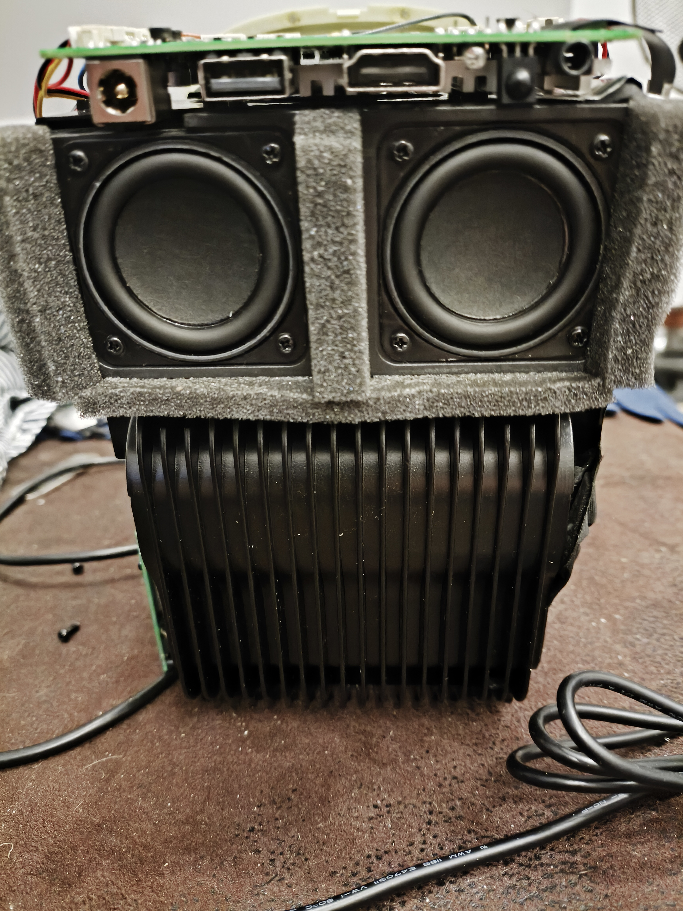
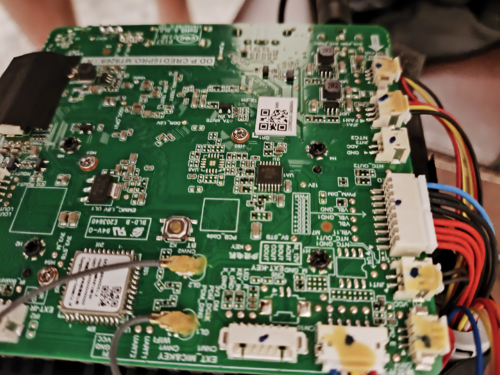
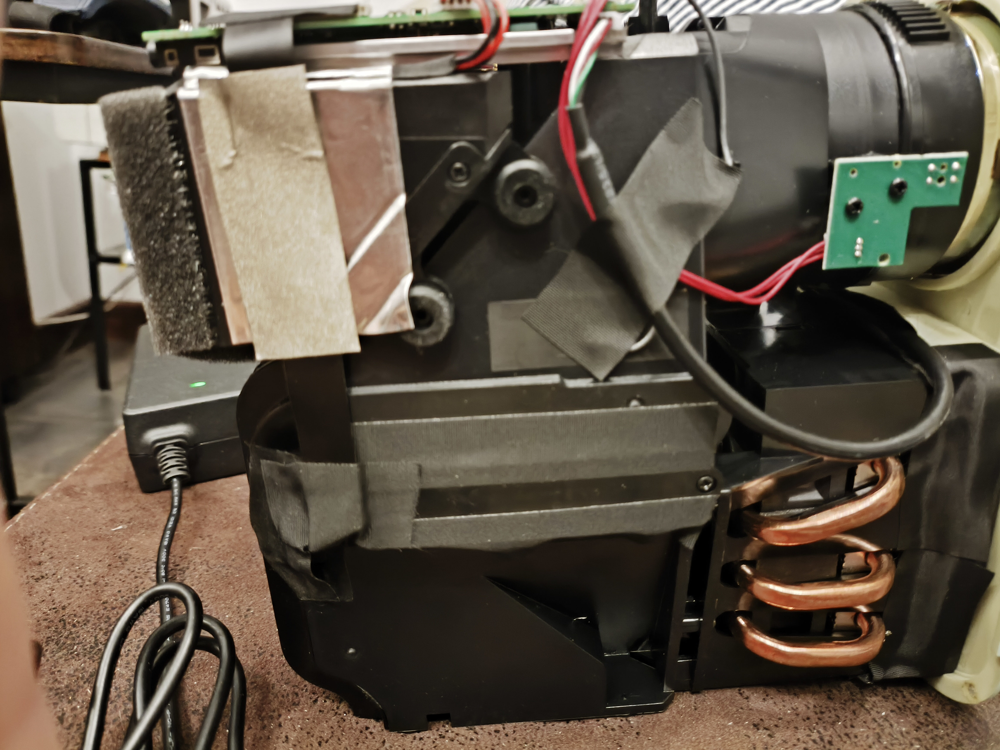

# Panda Stella A — 1080p Android projector

Hobbystyczna dokumentacja taniego projektora 1080p z Androidem: co siedzi w środku,
co da się z nim zrobić i nad czym jeszcze trzeba popracować.

> **Status:** projekt w toku. Działa sterowanie LED przez PWM, trwa walka z siecią.

## Spis treści

- [O projekcie](#o-projekcie)
- [Co działa, a co nie](#co-działa-a-co-nie)
- [Mod: PWM dla LED (ESP8266 + Tasmota)](#mod-pwm-dla-led-esp8266--tasmota)
- [Wentylatory FAN0 / FAN1](#wentylatory-fan0--fan1)
- [Środek obudowy](#środek-obudowy)
- [Znane problemy](#znane-problemy)
- [Roadmapa](#roadmapa)

## O projekcie

Tadam — z cyklu *Panda Stella* i *sterownik PWM*. Dlaczego producent nie dał tego
w oprogramowaniu? Nie wiem xD

Standardowo projektor nie pozwala sterować jasnością LED ani odciąć jej zupełnie.
Po rozebraniu obudowy okazało się, że na płycie głównej jest wyprowadzone `PWM_DIM` —
wystarczyło podać tam sygnał z zewnątrz.

Płyta główna: **OD.P.CRED16PRO.MT9269 (N)** (oznaczenie widoczne na PCB).

## Co działa, a co nie

| Funkcja | Stan | Uwagi |
| --- | --- | --- |
| USB — karty dźwiękowe | ✅ działa | da się mocno poprawić jakość dźwięku |
| USB — dyski i pendrive'y | ✅ działa | |
| USB — pady i kontrolery | ✅ działa | |
| Karta Ethernet | ❌ nie działa | prawdopodobnie problem kernela / okrojona aplikacja Settings |
| Karta Wi-Fi (USB) | ❌ nie działa | jw. |
| Moonlight (streaming) | ⚠️ działa, ale… | wąskim gardłem jest Wi-Fi — 7–26 Mbps, niestabilnie |

## Mod: PWM dla LED (ESP8266 + Tasmota)

Na ten moment do płyty podłączony jest **ESP8266 z Tasmotą**, a pilotem jest telefon.

Co można zrobić z telefonu:

- wcisnąć przycisk włącznika projektora,
- włączyć / wyłączyć LED,
- regulować jasność w zakresie **0–100%**.

Szczegóły montażu i podłączenia — patrz [film](https://www.youtube.com/watch?v=j7VabG2wWTw).
Dokładny pinout i schemat pojawią się tutaj, gdy tylko zostaną spisane.

## Wentylatory FAN0 / FAN1

Chciałbym dorzucić regulację obrotów, ale nie jest to proste: oba wentylatory są
sterowane **napięciowo**, każdy przez własną przetworniczkę. Będzie sporo grzebania.

| Złącze | Chłodzi | Domyślne napięcie |
| --- | --- | --- |
| `FAN1` | LED | 7 V |
| `FAN0` | LCD | 10 V |

## Środek obudowy

| | |
| --- | --- |
|  |  |
| Głośniki, radiator i złącza z tyłu obudowy | Płyta główna pod układem optycznym |
|  |  |
| Silnik optyczny i okablowanie | Płyta główna — sekcja LED i przetwornic |
|  |  |
| Złącza `FAN0` / `FAN1`, `PWM_DIM`, `LED_OUT` | Cała płyta: `OD.P.CRED16PRO.MT9269 (N)` |
|  | |
| Radiator, ciepłowody i zasilanie zewnętrzne | |

## Znane problemy

- **Sieć to wąskie gardło.** Mimo pełnego zasięgu łącze kręci się w okolicach
  7–26 Mbps i jest niestabilne — to psuje Moonlighta i wszystko inne, co wymaga
  przepustowości.
- Brak działających kart sieciowych USB (Ethernet / Wi-Fi).
- Sterowanie wentylatorami wymaga ingerencji w tor napięciowy.

## Roadmapa

- [x] Sterowanie LED przez PWM (ESP8266 + Tasmota)
- [x] Włącznik projektora z telefonu
- [ ] Regulacja `FAN1` (LED)
- [ ] Regulacja `FAN0` (LCD)
- [ ] **Lepsze łącze sieciowe — top prio**
- [ ] Spisany pinout i schemat moda

## Uwaga

Wszystko robisz na własną odpowiedzialność. Rozbieranie projektora i ingerencja
w zasilanie LED / wentylatorów może go uszkodzić albo skończyć się pożarem.
Jeśli nie wiesz, co robisz — nie rób tego.
